# 会务智办操作手册

[返回首页](../README.md) · [功能与边界说明](user-guide.md) · [下载 Word](downloads/会务智办操作手册.docx) · [下载 PDF](downloads/会务智办操作手册.pdf)

适用范围：**3.1.4 安装版及源码**。更新日期：2026-10-27。桌面软件仅提供安装程序，安装后通过快捷方式使用。面向日常安排会议、维护名单和跟进会务事项的使用者。

下载的 Word/PDF 与本页同步为 3.1.4，包含聊天历史保存、顶部会话切换与 AI 写入后页面自动更新；相关操作见第 17A 节及使用指南，旧截图不作为新界面的依据。

AI 修改通讯录、后台配置或撤销后，相关页面自动重读，无需手动刷新。已有人工草稿保留，冲突时提示核对；会议编辑窗口可选择“放弃草稿并读取最新版本”。

本手册截图来自独立演示环境。姓名、单位和车牌均为虚构示例，不包含真实业务资料或 API Key。座次和会议室章节使用 2026-10-08 改版截图，工作台和全局交互使用本轮独立演示环境截图，其他业务步骤保留 3.0.2 截图；当前搜索、页签提示和会议编辑窗口以第 25 节为准。截图中的日期、待办数量和进度仅用于演示；点击图片可查看大图，PDF 可放大阅读。

建议第一次使用依次阅读第 1-7 节；有正式名单、停车或座次需求时，再使用对应章节。不要为了完成流程而开启不需要的保障项目。

## 1. 启动软件与认识工作台

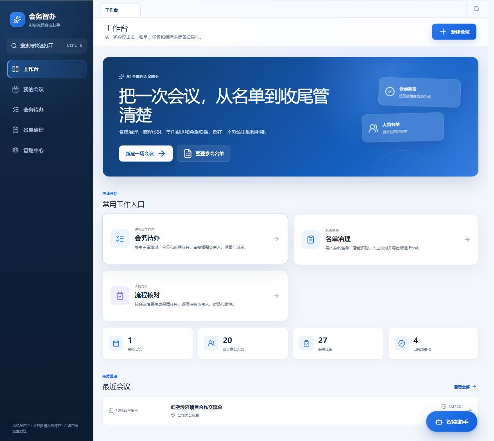

1. 从发布页下载安装程序，运行并选择安装目录，安装后从快捷方式启动。升级前先退出旧软件。
2. 打开后，左侧依次为“工作台”“我的会议”“会务待办”“名单治理”“管理中心”。右下角按钮打开智能助手。
3. 日常安排会议从“新建会议”开始；只整理一份名单、无需创建会议时，直接打开“名单治理”。
4. 源码网页版先完成依赖安装和构建，再运行 `start.bat`；使用期间不要关闭启动窗口。源码启动方法见首页。

> 安装程序自带运行环境，不需要另装 Node.js。从 3.0.4 正式发布起不再提供便携版。GitHub 的 Download ZIP 是源码，不是安装包。

## 2. 页面切换与未保存内容

顶部横向标签栏就是工作区。点击侧栏进入其他模块，再点击原页签，可继续填写原来的会议、名单或后台表单。

页签右侧“未保存 · 数量”可以集中查看未保存内容并切回处理；关闭前会提示，Escape 继续编辑。全局搜索与当前窗口示例见第 25 节。

1. 同一“新建会议”入口复用同一页签，不会另开一份空表。
2. 小圆点表示存在未保存内容。切换页面无需确认；关闭有修改的页签时，先核对丢失提示。
3. 新建会议成功后，原页签转换为该会议详情。会议详情可以各自打开独立页签。
4. 保存等当前页面操作进行时，允许切换页面，但不能关闭正在操作的页签。退出前请确认所有修改已经保存。

> **页面保活不是草稿存盘。** 刷新、关闭浏览器或退出软件后，未保存内容不会恢复。离开提醒出现时，应先取消离开并保存；已正式保存的会议和配置不受影响。

## 3. 新建会议：填写基本信息

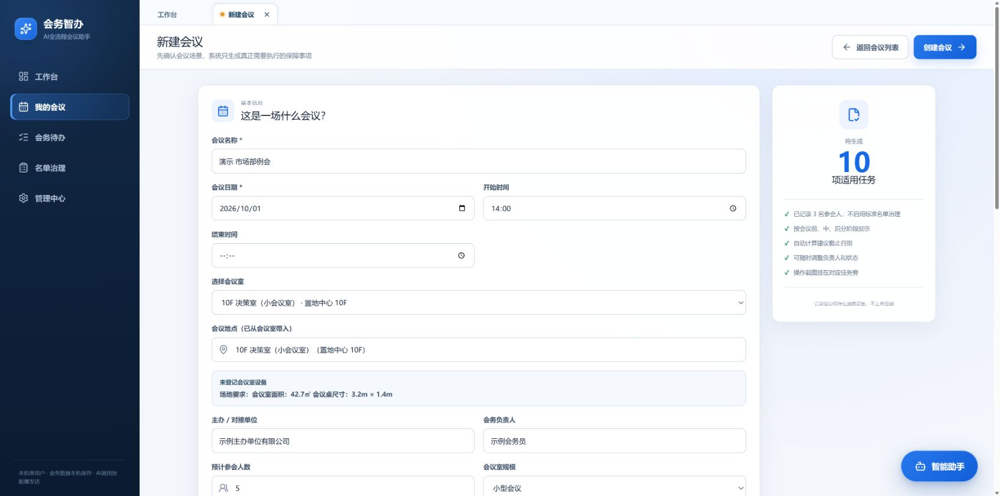

1. 点击“新建会议”，填写名称、日期、开始时间，按需要补充结束时间。
2. 在“会议室”中选已配置房间，系统带入场地信息；不使用内置会议室时，填写自定义地点。
3. 核对组织者、负责人和预计人数。默认值只是预填，可以按本次会议修改。
4. 查看页面右侧适用任务预览，再继续选择保障事项和录入人员。

> 不必先收到人员名单才能创建会议。只知道预计 5 人，也可以先保存会议；人员后续补录。同一已登记会议室的重叠时段会在保存时校验，结束时间建议填写明确。

## 4. 按需要选择会务保障

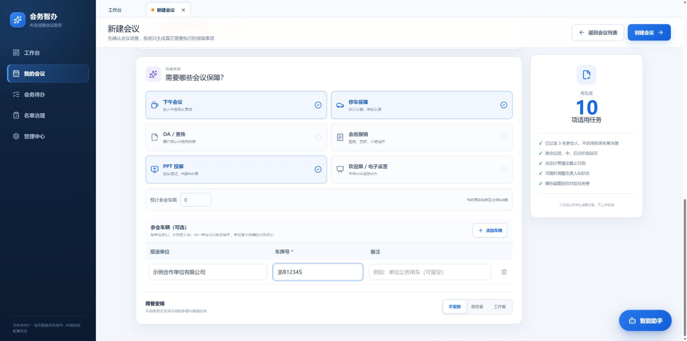

1. 按实际需要选择 PPT 演示设备、欢迎屏、停车、用餐、宣传、报销等选项。
2. 停车开启后，才会出现车辆登记入口；暂不清楚车牌时，可以先记录预计车辆数。
3. 不需要报销时保持关闭，不必查看报销操作指引。相关任务和指引按会议场景显示。
4. 预览生成的任务，确认后点击页面的创建按钮。后续可在会议详情“编辑会议信息”中修改。

> 勾选保障项会影响本次会议的适用清单，不是单纯备注。不要把所有选项都开启。关闭停车会隐藏入口，但保留已登记车辆。

## 5. 录入参会人员：手动或粘贴批量识别

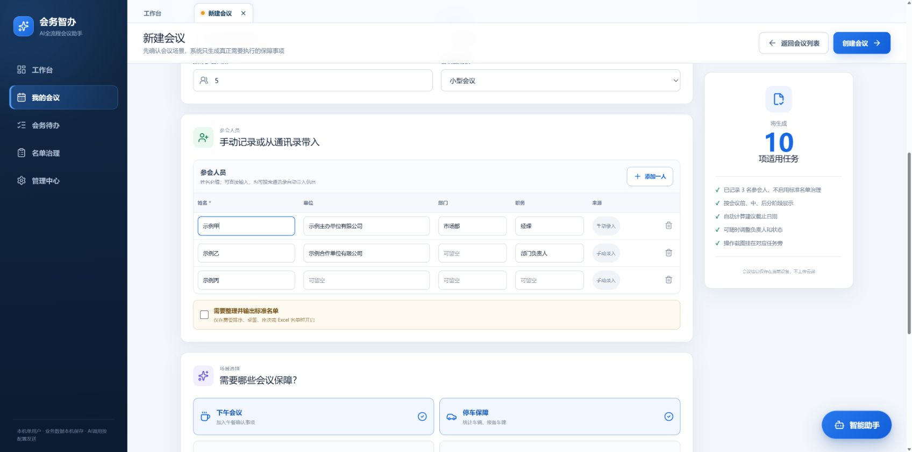

1. 在“参会人员（可选）”中新增行，填写姓名；单位、部门、职务可留空。
2. 批量录入时展开“粘贴名单，批量添加”，粘贴一段人员介绍、用顿号分隔的姓名列表或 Excel 表格，点击“识别人员”。新建会议和会议详情人员页都可使用。
3. 核对预览中的姓名、单位、部门、职务及提醒，点击“确认添加到人员表”。添加后可逐项修改或删除；同姓名、同单位的重复记录跳过并保留原有手填信息，同名不同单位分别保留。
4. 使用现有 AI 模型设置，未配置或调用失败时按本地规则识别。复杂段落建议配置 AI 后识别；简单名单可按每人一行粘贴。单次最多 100,000 字，超限须拆分。
5. 可以只记录部分人员或只保留预计人数。“需要整理并输出标准名单”仍独立选择，批量添加不会自动开启。
6. 确认添加后创建会议，或在详情点击“保存人员”，才会持久化。仍有未确认的粘贴名单时，先确认添加或清空；切换工作区页签可继续编辑，刷新或退出不会保留未保存内容。

> 上图为旧版逐人录入示意，不展示新增的粘贴入口；批量录入请按本节文字步骤操作。

> 添加人员不会自动开启名单治理。只填姓名的人可以保存到会议；单位缺失时暂不进入通讯录，补齐单位并再次保存后才同步。

## 6. 从通讯录快速选人

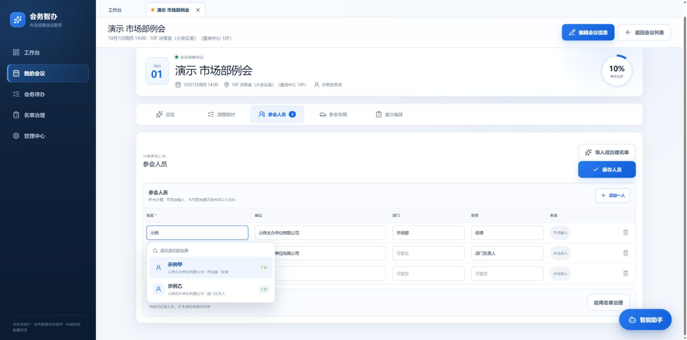

1. 新建会议或会议详情“参会人员”分页中，在姓名框输入部分姓名、单位或职务。
2. 从下拉结果核对姓名和单位，选中正确联系人。
3. 系统自动带入单位全称、部门和职务。旧信息不准确时，可以在本次会议里继续修改。
4. 会议详情修改完成后点击“保存参会人员”，查看成功提示，以及暂未同步通讯录的人数。

> 选中联系人比直接输入同名更可靠。同名但不同单位可能是不同人，请勿只凭姓名合并。通讯录有旧简称时，先在后台维护准确的单位字典。

## 7. 查看会议进度与流程核对

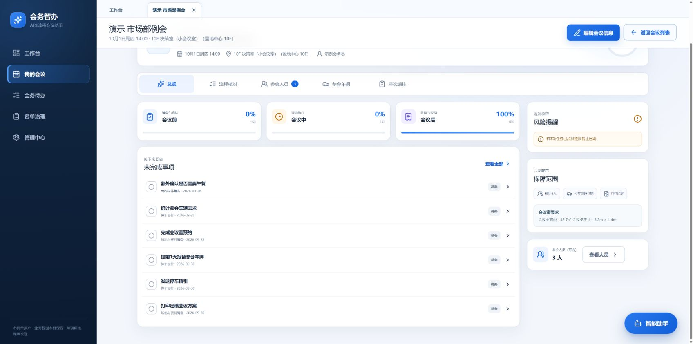

1. 保存会议后打开详情，在“总览”查看整体进度、会前/会中/会后进度和风险提示。
2. 打开“流程核对”查看本次实际生成的事项。任务随场景生成，不是所有会议都有完整 29 项。
3. 从任务进入详情，填写负责人、截止时间、状态和备注，再按实际完成情况更新。
4. 人员、停车车辆和座次使用各自分页维护，不需要挤到同一个名单表里。

> 某阶段没有适用事项时，进度为 **100%**，并显示无需额外操作。它表示该阶段无任务，不表示其他阶段全部完成。截图演示会议没有会后事项。

## 8. 更新任务与记录办理情况

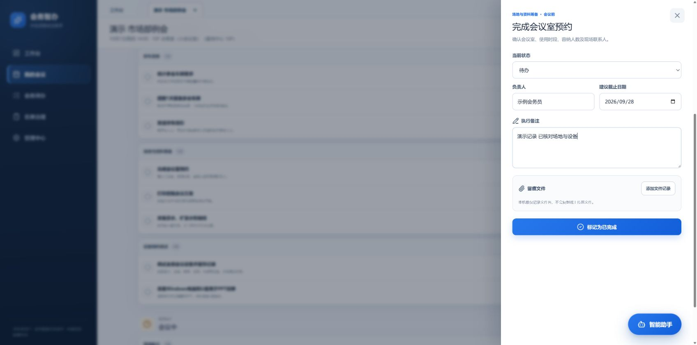

1. 点击任务打开右侧详情，核对任务说明、关联会议和截止日期。
2. 分配负责人，填写办理备注；实际完成后点击“标记为已完成”或调整状态。
3. 尚未办结可以使用“进行中”“阻塞”“待复核”等状态；确实不适用时选“无需执行”。
4. 查看保存状态和会议进度，确认修改已经生效后再关闭详情。

> 任务字段修改会保存，不需要再去管理中心发布配置。留痕只记录文件名，**不会备份、上传或保存文件原件**；重要原件请另行归档。

## 9. 在待办中心集中处理事项

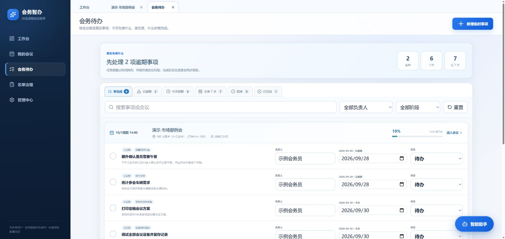

1. 点击“会务待办”，优先查看逾期、今天到期和未来 7 天事项。
2. 使用负责人、会议阶段和关键字筛选，缩小本次要处理的范围；“重置”清除筛选。
3. 直接在对应任务行调整负责人、日期或状态；完成后所属会议进度同步更新。
4. 点击“新增临时事项”补充会议实际需要的额外任务，并核对所属会议、阶段和截止时间。
5. 需要查看完整背景时，点击会议卡片“进入会议”。

> 当前筛选无结果不代表系统里没有任务。先清除筛选再核对；“已完成”用于查看已办事项，不能把未办理任务直接当作完成。

## 10. 停车车辆按单位独立登记

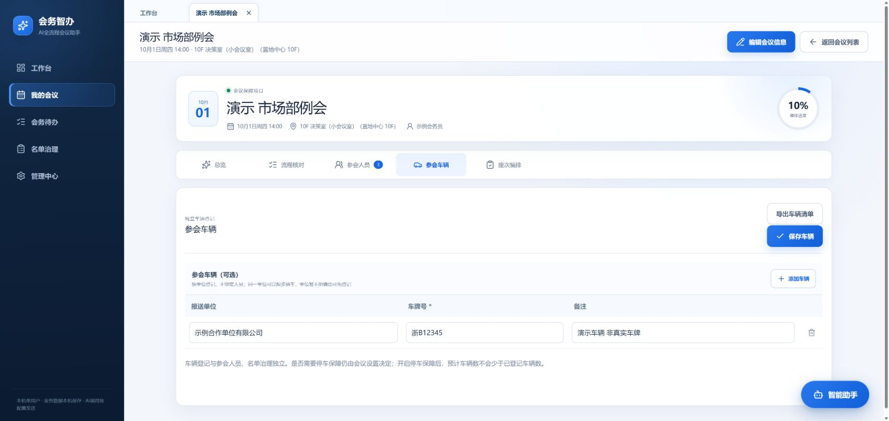

1. 在会议中开启停车保障，再进入“车辆登记”。
2. 新增车辆行，填写单位、车牌号和必要备注；同一单位可以登记多辆车。
3. 核对车牌，点击“保存车辆”，确认成功后再切换页面。
4. 需要发给停车保障人员时，点击“导出车辆清单”，复查导出内容后使用。

> 车牌不绑定某个人，不会写入人员通讯录或正式人员名单。截图车牌为虚构演示。停车已开启时，预计车辆数不能低于已登记车辆数。

## 11. 正式名单：选择人员来源

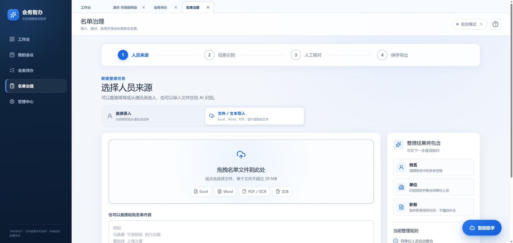

1. 会议关联名单：从会议“参会人员”分页进入名单治理；非会议场景：使用左侧独立“名单治理”。
2. 没有名单文件：选择“直接录入”并点击“开始录入”，填写表格或从通讯录选人，无需 API Key。
3. 已收到文件：选择“文件 / 文本导入”，拖入 Excel、Word、PDF、图片或文本，或直接粘贴名单。
4. 文件和文字准备好后点击“开始智能整理”。规则模式可处理较规范内容；复杂语义识别应先配置 AI。

> 单文件不超过 20 MB，名单合计不超过 100,000 字；单个工作表最多 5,000 行。扫描 PDF/图片需要 OCR，首次可能下载资源；PDF 最多 60 页，其中扫描页最多 30 页。超限请拆分。

## 12. 核对姓名、单位和排序建议

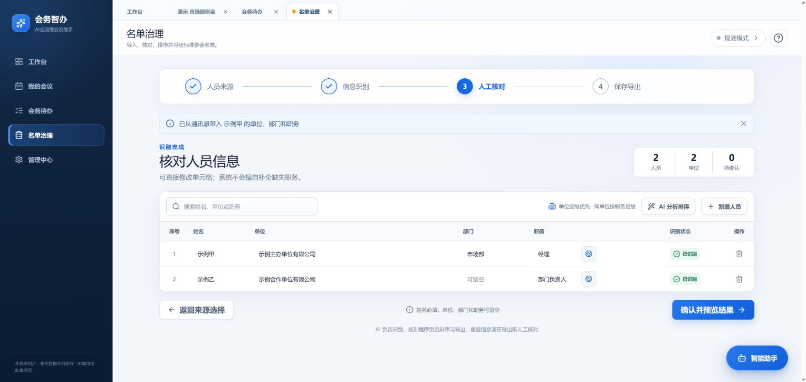

1. 在“核对人员信息”中逐项修改姓名、单位、部门、职务，处理缺失和重复提示。
2. 检查单位简称归一候选；不确定是否同一单位时，不要直接合并。
3. 需要辅助判断单位层级时点击“AI 分析排序”；需要核验职务时点击对应职务旁的联网按钮。
4. 先核对公开来源、人物身份和信息时间，再确认采用建议。职务缺失可保持空白，不要求强行补全。
5. 核对完成点击“确认并预览结果”。

> AI 和联网结果是建议，不是权威礼序。联网核验还需在助手设置中启用搜索服务并填写搜索 Key；仅配置大模型 Key 不等于开通搜索。只有姓名时可能存在同名，不能自动认定身份。

## 13. 导出或写回会议名单

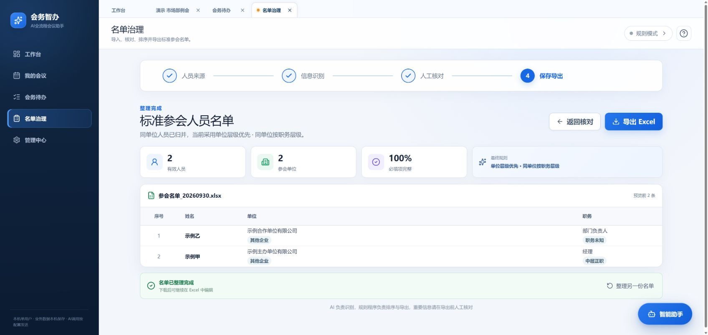

1. 预览最终顺序，检查人数、单位、职务空值和输出列。默认四列：序号、姓名、单位、职务。
2. 发现问题点“返回核对”；确认正确再点击“导出 Excel”。导出格式由管理中心配置。
3. 在会议关联模式中保存整理结果前，系统会提示**替换当前会议人员**；核对后再确认。
4. 确认写回后启用正式名单流程；取消替换时原会议人员不变。独立工具导出不会自动写入某场会议。

> 预览中的“必填项完整”不代表单位层级、职务或来源已经经过人工核验。单位同层级时可能使用次级规则排序；未知职务需要检查，不能只看序号。

## 14. 生成并保存座次方案

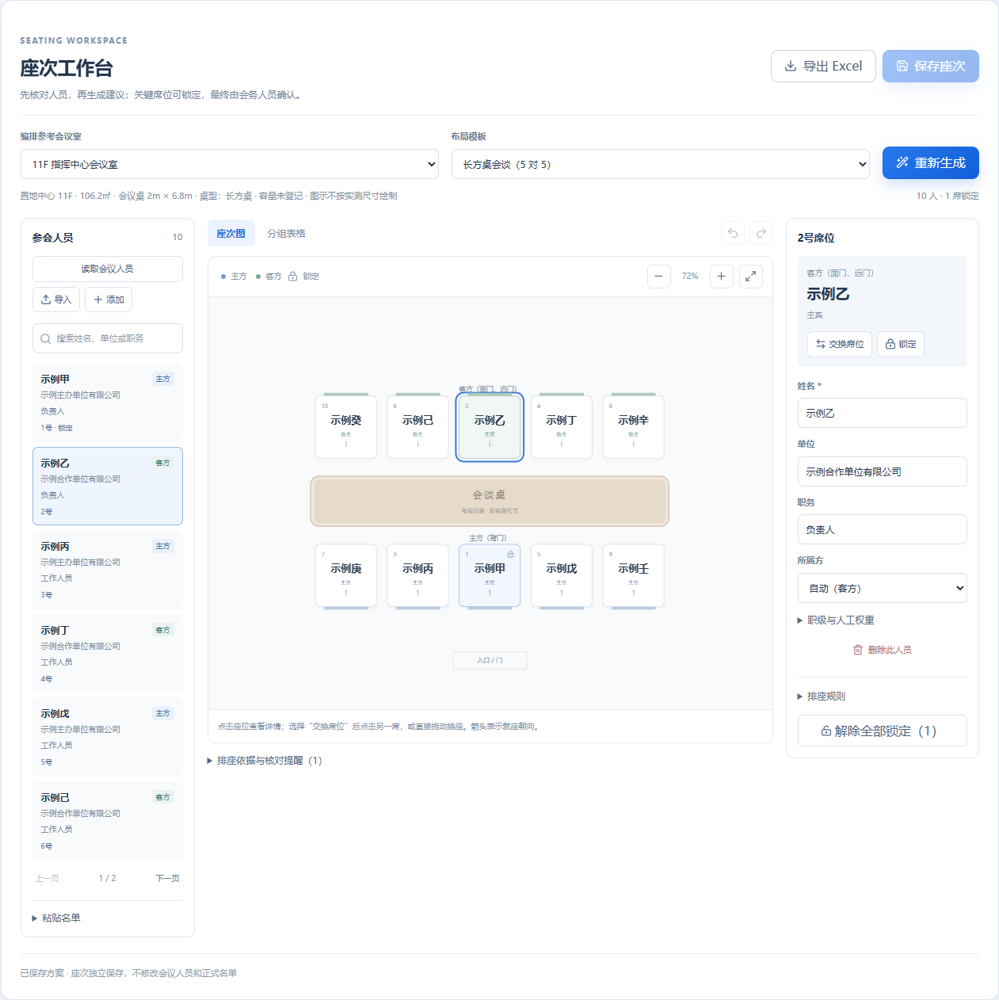

1. 打开会议详情“座次编排”。左侧读取本次会议人员、添加人员或导入名单；支持通讯录搜索和粘贴表格。
2. 核对姓名、单位、职务/职级、所属方和主持人；不明确的职级可逐人设置人工权重。
3. 首次编排按会议已选会议室自动带入桌型；切换参考会议室也会带入对应模板，仍可临时改选布局。右侧“排座规则”设置入口、主位、主持人及中心方式，再生成座次。
4. 点击图中座位，右侧查看人员详情与席位标签。选择“交换席位”后点另一席，或在桌面上直接拖动换座。
5. 确认后保存到本会议，或导出 Excel 供现场布置。

6. 关键席位可以锁定。重新生成会保留兼容布局中的锁定人员与位置；更换模板、入口或中心布局不兼容时，先解锁再生成。锁定随方案保存，重新打开仍存在。
7. 图形工具栏可放大、缩小或适应窗口；点击左侧人员可定位座位。用撤销/重做恢复本页最近 60 步操作，切换“分组表格”查看完整字段。
8. 修改人员或规则后，旧图保留并提示重新生成，此时暂不能保存或导出。粘贴的名单也须先读取或清空。保存与导出始终在工作台顶部。

> 默认 2 号在 1 号就座者的左手侧，即单排图上右侧；会谈双方根据各自朝向镜像排列。座次规则只是辅助建议，参考会议室不改变原预订场地，图示不是实测平面图，不按面积猜容量。**座次权重越大越靠前**；后台名单规则优先级越小越靠前。保存座次不覆盖参会人员，也不开启名单治理。撤销记录不跨刷新保存。

> 长方桌带入普通会谈模板，不自动选择 5 对 5；圆桌带入圆桌模板；主席台 / 排座带入自动单/双中心；未配置桌型不替换当前布局。已保存的座次优先用原模板，不被后台桌型变化覆盖。主动换会议室后须核对并重新生成；锁定不兼容时先解锁。

## 15. 配置云端大模型

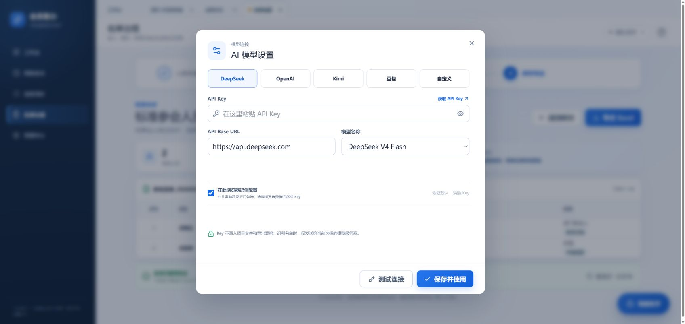

1. 点击名单页右上角模式按钮，或打开智能助手设置。
2. 选择 DeepSeek、OpenAI、Kimi、豆包或自定义接口；点击“获取 API Key”前往对应官网获取自己的 Key。
3. 填入 Key，核对 Base URL，在下拉框选择模型；服务商需要接入点 ID 时使用自定义模型名称。
4. 名单页可点击“测试连接”，成功后“保存并使用”；助手设置使用对应保存按钮。
5. 公共电脑取消“在此浏览器记住配置”，使用后清除 Key。

> 不需要本地部署大模型。模型调用需要联网、账号权限和调用额度。预置名称不代表你的账号都能使用，实际以服务商为准。本手册没有填写真实 Key，也没有进行付费模型调用验证。

## 16. 用智能助手联动系统

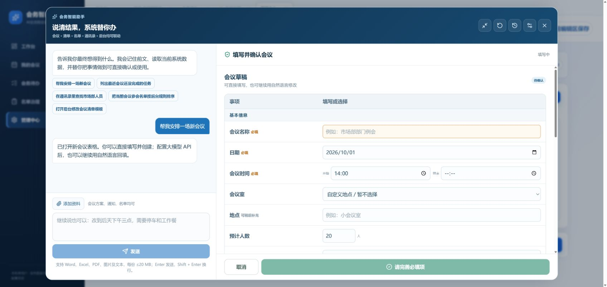

1. 点击右下角“智能助手”；需要更大空间时点击顶部“展开工作区”。出现草稿时，左侧对话、右侧核对。
2. 用自然语言说清目标，例如：“创建明天下午两点的市场部例会，5 人，不用报销。”后续可继续说“地点改成 10F 决策室”。
3. 核对草稿表格或操作预览，必要时直接修改；检查日期、对象和将受影响的数据。
4. 点击创建或“确认执行”后，才写入系统。打开页面等固定导航操作不需要模型；复杂理解需要已配置的大模型。
5. “操作历史与撤销”可检查已执行操作；后续数据有变化时，系统可能拒绝撤销以防覆盖新修改。

可直接尝试：“列出最近会议没完成的任务”“在通讯录里查找市场部人员”“把当前会议参会名单按后台规则排序”。聊天输入 Enter 发送，Shift + Enter 换行。

> 助手不是无限权限代理：只执行系统支持的操作，不运行任意代码，也不会自动给外部联系人发消息。普通写入先预览确认；通知、议程等文字成果需人工核对后自行使用。

## 17. 上传资料辅助填报会议

1. 在助手输入区点击“添加资料”，选择会议方案、通知或名单，检查附件和解析状态。
2. 点击“识别并填入会议草稿”，等待 AI 提取会议名称、时间、地点、议程、人员及明确给出的车辆信息。
3. 在右侧草稿逐项核对，补齐必填信息，确认停车、用餐、名单治理等是否真的需要。
4. 有错误可直接改表格，也可继续对话修改；确认后创建会议。

每次最多 5 份资料，每份 20 MB / 24,000 字，合计 60,000 字。扫描资料可能使用 OCR；限额超出时先拆分或减少附件。附件入口见上一节截图左下角。

> 识别文字会按配置发给第三方模型，上传前确认资料允许出网。附件仅在本次会话保留，刷新即丢失；文件原件不归档，确认后保存的是结构化信息。**本系统“上报”指录入会议，不代表已经提交公司 OA 或完成审批。**

## 17A. 编制会议方案并下载 Word

1. 保存会议，进入该会议的“会议方案”页签，核对自动带入的时间、地点和人员。
2. 填写背景，添加议程；可调整人员组名、分组和顺序，集体描述单独填写。
3. 需要 AI 时点击“AI 帮写背景”或“AI 编排议程”，在现有助手中补充要求并发送；核对预览后确认采用，再回到编辑区继续修改。
4. 点击“全文预览”，核对背景、基本信息和议程三个章节，再“保存方案”或“保存并下载”。有缺项时先补齐，或确认导出草稿。
5. 会议信息变化后点击“查看差异并同步”，逐项选择更新；不重置背景、议程和自定义分组。下载后手动确认会前待办完成状态。

点击助手顶部“对话历史”图标，浏览所有对话的标题、最近消息及时间；可搜索标题或聊天内容，点击任一条继续。顶部标题处也可快速切换会话，“新建会话”图标新增对话并保留原会话。每个会话的聊天记录、标题和当前选择自动保存到本机，刷新后可恢复并接着提问；不同浏览器及不同端口不自动同步。输入区下方显示历史保存状态，失败时会提示。

同一次 AI 会话可以跨业务页签连续办理，各会话可切换、并行生成和停止。切页不改变已经发起请求的目标；新修改与旧结果冲突时重新生成，避免覆盖。附件及未保存草稿仅在当前页面会话保留，待确认操作及未完成请求不会随刷新恢复或重新执行。

> Word 沿用上传模板的 A4 页面、页边距、标题及正文样式，可继续在 Word/WPS 编辑。AI 不改变模板框架，不自动补造姓名、职务或确定的安排；无 API Key 也能手工完成。

## 18. 维护人员通讯录

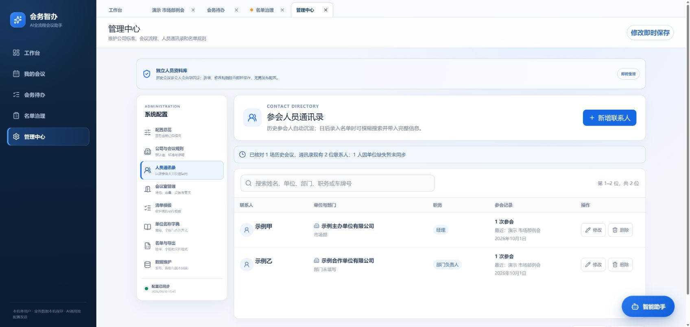

1. 打开“管理中心 → 人员通讯录”，可按姓名、单位、部门或职务搜索。
2. 新增使用“新增联系人”；更正已有资料使用该行“修改”，不要再新增一遍。
3. 单位输入支持模糊搜索，选中标准单位后显示全称；核对部门和职务，再保存当前联系人。
4. 检查成功提示及搜索结果。通讯录即时保存，不需要点击配置发布。

> 通讯录按“姓名 + 已配置的标准单位全称”去重。同名不同单位仍保留；未知简称不猜测归并。会议中单位缺失的人暂不沉淀，补齐后再次保存。修改通讯录不应理解为自动重写所有历史会议快照。

## 19. 配置会议室

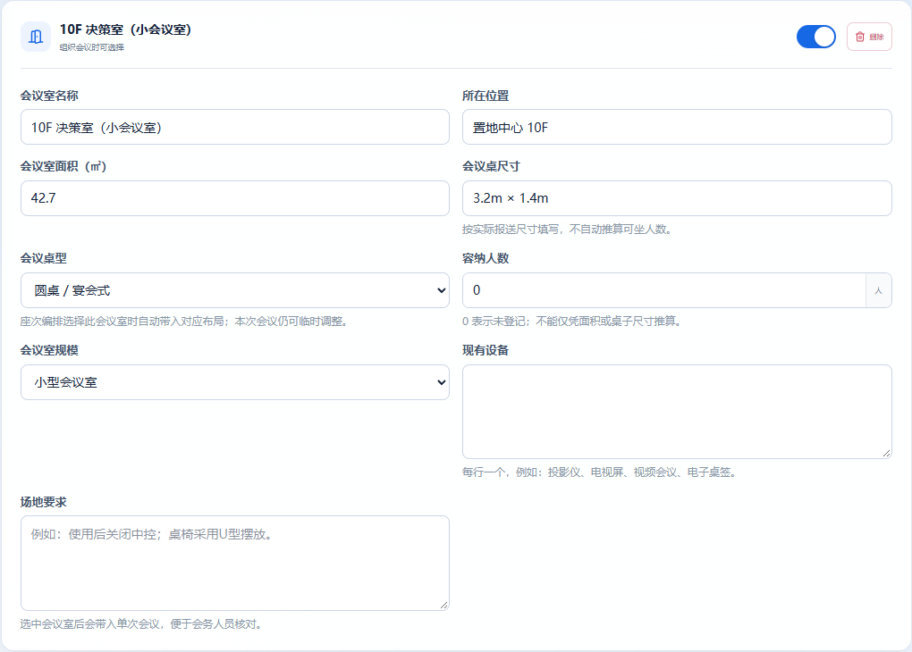

1. 打开“管理中心 → 会议室管理”，新增或修改名称、位置、面积、桌子尺寸、容纳人数和规模。
2. 在“会议桌型”选择长方桌、圆桌 / 宴会式或主席台 / 排座，不确定时保留“未配置”。座次编排会据此自动选模板，仍可按本次会议临时调整。
3. 设备、场地要求可以每行填写一项；用启用开关决定是否供新会议选择。
4. 按需要设置默认会议室；不确定时保留“不预设会议室”。
5. 点击本页底部“保存会议室”。这个按钮只保存会议室，不会提交其他管理页的草稿。

内置置地中心 6 间会议室：10F 决策室、11F 指挥中心会议室、11F 洽谈室1/2、12F 党建会议室、12F 洽谈室1。未提供 24F 房间资料，因此没有新增该楼层房间。

> 容纳人数 0 表示未登记，不代表可坐 0 人；请按实际登记，不从面积或桌子尺寸推算。内置和旧会议室默认未配置桌型，请按现场情况维护。升级不覆盖已经维护的会议室信息。选房间后，场地资料作为本次会议快照保存。

## 20. 统一单位全称与简称

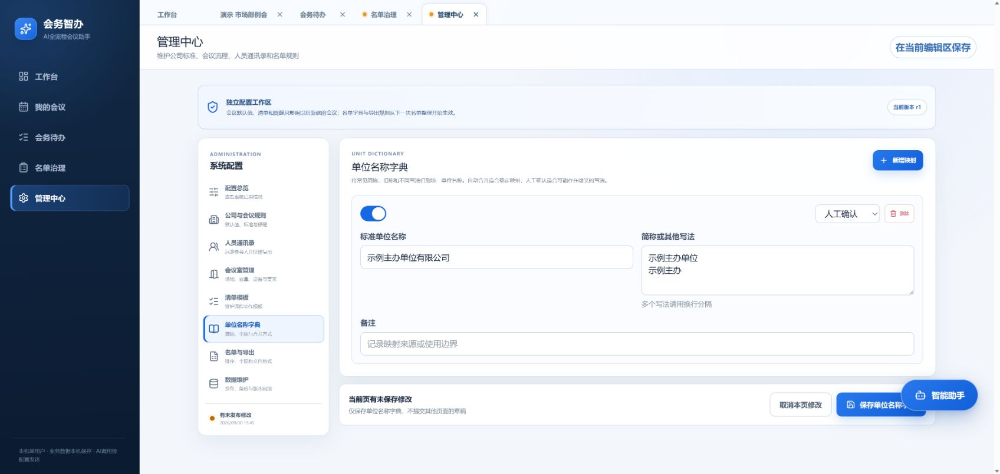

1. 打开“管理中心 → 单位名称字典”，点击“新增映射”。
2. 在“标准单位名称”填写确认过的全称；在“简称或其他写法”每行填写一个别名，可以直接按 Enter 换行。
3. 完全确定的关系可选择“自动合并”；存在歧义时保留“人工确认”，补充备注。
4. 点击“保存单位名称字典”，确认已生效，再处理后续名单或通讯录。

> 名称相似不等于同一法人单位。集团与子公司、上级与下级单位不应随意合并。字典是规则依据，应由熟悉业务的人维护。

## 21. 配置排序、导出和会务模板

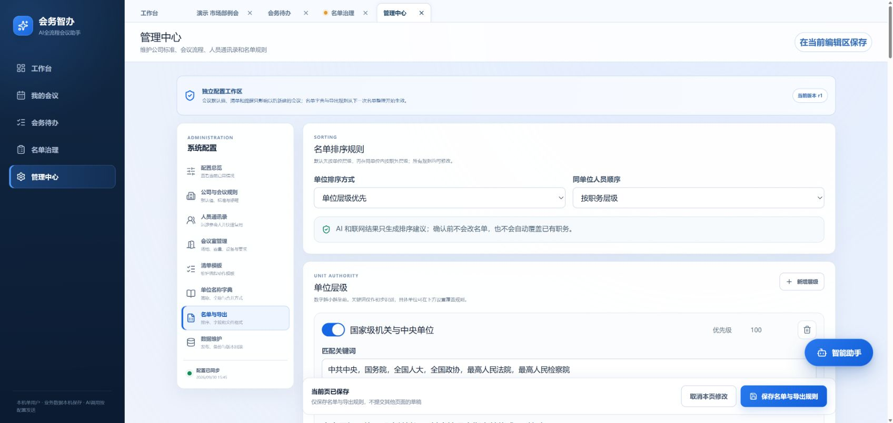

1. 打开“管理中心 → 名单与导出”，选择“单位层级优先”和“按职务层级”；旧配置可能仍使用拼音兼容模式，请检查。
2. 维护单位层级、指定单位优先级和职务关键词。**优先级数字越小越靠前**，不确定的单位用精确全称覆盖，不只凭名称猜层级。
3. 在同页下方选择输出字段、表头、列宽、文件名和工作表，点击“保存名单与导出规则”。
4. 修改新会议默认值去“公司与会议规则”；调整任务阶段、条件、截止日期等去“清单模板”，使用各自本页保存按钮。

> 管理中心不是所有更改都自动保存：通讯录即时保存，规则页需要本页保存。公司默认值和清单模板影响以后新建的会议，不覆盖已有会议任务；字典和名单输出规则在后续整理/导出使用。全新业务类型仍需开发，不是仅改配置就能增加。

## 22. 会议检索、复制与回收站

1. 在“我的会议”按名称、地点、负责人或组织单位搜索，并使用时间范围筛选。
2. 打开目标会议再编辑，避免在同名会议之间操作错对象。定期会议可复制后核对新日期、人员和场景。
3. 已结束会议可归档，归档不是删除；需要时恢复。
4. 普通删除先进入回收站，误删可恢复。彻底删除前先备份，并仔细阅读不可恢复提示。

> 复制后的会议信息仍需核对，不能把旧日期、旧名单直接当作本次安排。助手执行复制、删除等也要核对预览对象。

## 23. 数据备份与迁移

1. 管理中心“数据维护”可导入/导出配置、查看版本和回滚配置；操作前先保留当前配置副本。
2. **配置导出不是全量备份**，不包含全部会议、通讯录、附件原件或 API Key。
3. 备份全部业务数据：先退出软件并停止网页版服务，再复制整个数据文件夹到安全位置。
4. 安装版和默认网页版目录：`%LOCALAPPDATA%\MeetingAssistantAI`。自定义数据目录以实际配置为准。
5. 换电脑时先安装软件，再迁移已备份的数据；有现有数据时不要直接覆盖。历史便携数据仍在旧 EXE 旁“会务智办数据”，不会自动合并到安装版。浏览器和桌面版的模型 Key 不会自动互相复制。

> 配置回滚不能恢复已删除会议或联系人。不要只复制程序文件就以为带走了全部数据；不要清理不认识的数据文件。敏感备份不要上传 GitHub。

## 24. 常见问题与完成检查

| 情况 | 先这样处理 |
| --- | --- |
| 切回来内容还在，但重启后没了 | 页面保活仅限本次使用。关键节点点击正式保存，不依赖未保存草稿。 |
| 明明有任务，待办页看不到 | 清除关键字、负责人、阶段和状态筛选，再查看所属会议。 |
| 会后显示 100%，但整体未完成 | 会后没有适用事项；整体仍按所有实际任务计算。 |
| 联系人没同步到通讯录 | 检查单位是否为空，补齐后保存会议人员。 |
| 人名相同但出现两条 | 核对单位是否不同，或简称尚未映射。不要仅按姓名强制合并。 |
| 找不到车辆入口 | 先核对该会议是否开启停车保障。 |
| AI 调用失败 | 测试 Key、地址、模型权限和余额，检查网络；不要反复提交造成重复操作。 |
| 不能联网补职务 | 搜索服务另需启用和搜索 Key；核对同名人物及来源时效。 |
| 后台修改没有生效 | 点击当前管理页保存，查看成功提示；通讯录除外，它即时保存。 |
| 页面连接失败 | 确认软件/服务正在运行；网页版检查启动窗口和端口占用。不要把 Key 发给别人排查。 |

业务确认默认聚焦“取消”，按 Escape 可取消。若按钮可点但输入框无法聚焦，使用“视图 → 恢复输入焦点”（Ctrl+Shift+F6），或切到其他窗口再返回；无需刷新或重启。

会前最后检查：会议时间地点正确；人员与预计人数已核对；停车、用餐、报销只开启需要的项；任务有负责人；正式名单和座次经人工确认；导出材料复查完成；重要资料原件另行归档。

更多功能边界见[使用指南](user-guide.md)。AI 建议须人工核对；本系统不提交外部审批或发送通知。

## 25. 快速查找和统一操作反馈

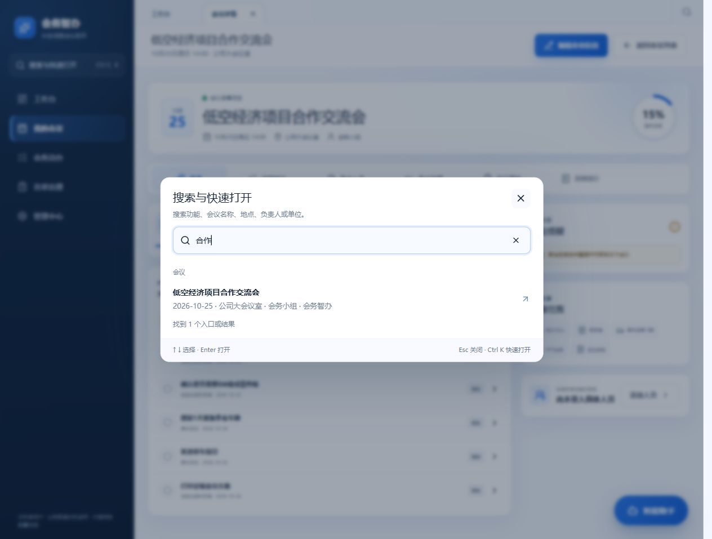

1. 点击侧栏“搜索与快速打开”、页签右侧放大镜，或按 Ctrl+K。输入功能、会议名称、负责人，可直接打开结果；通讯录和会议室也可直达。方向键选择、Enter 打开、Escape 关闭。
2. 页签右侧显示“未保存 · 数量”时，点击查看哪些页面尚未保存，再切回相应页面处理。关闭页签默认继续编辑，确认放弃后才丢弃；草稿不跨重启保存。
3. 会议编辑只滚动正文，顶部关闭和底部保存固定可见；小窗口也可操作。保存校验失败会保留填写内容并定位错误字段。确认放弃后取消，仍可继续输入。可查看[小窗口编辑示例](images/manual-ux/meeting-editor-small.png)。
4. 会议与待办写入成功后显示“已保存”提示。管理中心规则仍需本页保存；通讯录仍即时保存。临时事项或资料导入未保存时，关闭会先确认。
5. 会议、待办列表显示筛选状态和数量，没有结果时可清除筛选。连接错误需重试，不能当作数据已被删除。

> 快速搜索在本机进行，不调用 AI。切换页签保留当前会话的工作内容，仍需按页面规则完成保存。
